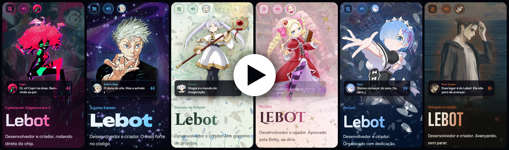

<div align="center">

# Lebot · Portfólio temático

**Um portfólio. Dez guias. Cada um com a própria voz.**

Escolha um personagem de anime para guiar a visita: o site inteiro muda (cores, fontes, cenário, partículas 3D e artes) e o guia **fala com a própria voz**, reagindo ao que você clica, toca, passa o mouse e rola na página.

[**Abrir o site**](https://lebot007.github.io/site-temas/) · [Versão no Vercel](https://lebot.vercel.app/) · [Assistir à apresentação](https://lebot007.github.io/site-temas/assets/video/apresentacao.mp4)

<a href="https://lebot007.github.io/site-temas/assets/video/apresentacao.mp4">
  
</a>

<sub>Vídeo de apresentação (54 s, formato Reels): clique na imagem para assistir. Arquivo em <a href="assets/video/apresentacao.mp4"><code>assets/video/apresentacao.mp4</code></a>.</sub>

</div>

---

## Os guias

| Guia | Anime | Clima do tema |
|---|---|---|
| Capri | Cyberpunk: Edgerunners 2 | neon rosa e ciano de Night City |
| Satoru Gojo | Jujutsu Kaisen | o Vazio Infinito em azul e violeta |
| Ryomen Sukuna | Jujutsu Kaisen | brasa vermelha do santuário |
| Ken Kaneki | Tokyo Ghoul | chuva fina de Tóquio, preto e carmim |
| Frieren | Sousou no Frieren | campo florido em branco e verde |
| Emilia | Re:Zero | gelo prateado e lilás |
| Beatrice | Re:Zero | biblioteca rosada ("eu diria") |
| Rem | Re:Zero | noite azul |
| Eren Yeager | Shingeki no Kyojin | pôr do sol de batalha, fase do Rumbling |
| Thorfinn | Vinland Saga | campo de trigo dourado ao sol |

Dá para abrir direto com um guia pelo link: `?p=gojo`, `?p=rem`, `?p=thorfinn`…

## O que tem no site

- **Troca de tema animada:** no computador, o tema novo é revelado num círculo que nasce do botão; no celular, uma cortina na cor do personagem cobre a tela, o tema troca por baixo e ela se dissolve (sempre anima, sem piscar o tema antigo).
- **Voz dos personagens:** 71 falas por guia (710 no total). Ligada no botão do topo, o guia cumprimenta, comenta cada seção quando você chega nela, reage às redes sociais, às artes da galeria, às frases e a quando você fica parado. A legenda aparece numa caixa de diálogo com o rosto do personagem, e ele "fala" no palco com um movimento suave acompanhando o volume da voz.
- **Perfil do personagem:** história, personalidade, ficha e frases famosas (cada frase toca na voz dele).
- **Galeria:** artes oficiais e fanarts com crédito do artista.
- **Redes:** Instagram, TikTok, Twitch, Spotify, GitHub e Discord (clique para copiar o usuário).

## Feito para qualquer tela

- **Responsivo** de celular pequeno a TV 4K, com layout próprio para celular, tablet, notebook e monitor grande.
- **Desempenho adaptativo:** mede o aparelho (núcleos, memória, tela, toque, economia de dados) e escolhe o nível de efeitos; se o FPS cair, reduz sozinho. No rodapé dá para escolher: Máximo, Equilibrado, Leve ou Sem animação.
- **Acessível:** navegação por teclado (inclusive setas na seleção e na galeria), foco visível, textos alternativos e respeito ao "reduzir movimento" do sistema.
- **Compatível** com Chrome, Edge, Firefox, Safari (iPhone/Mac), Samsung Internet e navegadores de TV.
- **Seguro:** sem chaves nem APIs no site, com Content-Security-Policy e cabeçalhos de segurança.

## Tecnologia

HTML, CSS e JavaScript puros, sem build e sem dependências. Partículas 3D em WebGL 1 rodando na GPU, View Transitions no computador, Web Audio para animar a fala, Web Animations para a cortina do celular.

```
index.html
assets/
  css/main.css          estilos e os 10 temas
  js/app.js             troca de tema, seleção, reações, galeria, cortina do celular
  js/temas.js           cores, fontes e atmosfera de cada personagem
  js/perfis.js          história, personalidade, ficha e frases
  js/voice.js           sistema de voz (prioridades, fila, legenda)
  js/fx.js              partículas 3D em WebGL
  js/perf.js            detecção do aparelho e nível de qualidade
  img/<personagem>/     recorte, avatar, fundo e galeria (WebP)
  voz/<personagem>/     falas em MP3 + manifest.json
  video/                vídeo de apresentação
  data/imagens.json     lista de imagens e créditos
scripts/                ferramentas que geraram os assets (não rodam no site)
```

## Como as vozes foram feitas

As falas foram geradas **localmente** com o OpenAudio S1-mini (modelo aberto da Fish Audio, rodando na GPU), clonando a voz de referência de cada personagem. Cada fala foi conferida por transcrição automática (frase completa, sem corte), timbre e ruído antes de entrar no site.

```
python -I scripts/preparar_referencias.py   # monta a voz de referência de cada personagem
python -I scripts/gerar_local.py            # gera as falas de scripts/falas.json, escolhe as melhores e finaliza
python -I scripts/auditar_vozes.py          # audita timbre, tom, ritmo, texto e ruído de todas as falas
python -I scripts/baixar_artes.py           # baixa artes para _acervo/ (fora do git)
python -I scripts/processar_imagens.py      # recorta e otimiza para assets/img/
node scripts/teste_troca_celular.mjs        # testa a troca de personagem em modo celular (com o site rodando local)
```

## Créditos

Personagens e artes oficiais pertencem aos seus autores e estúdios (MAPPA, Studio Pierrot, Madhouse, White Fox, WIT Studio, Studio Trigger, CD PROJEKT RED e editoras). As fanarts pertencem aos artistas creditados na galeria do site (o crédito aparece ao abrir cada imagem). Projeto de fã, sem fins comerciais.

Código sob a [licença MIT](LICENSE).
